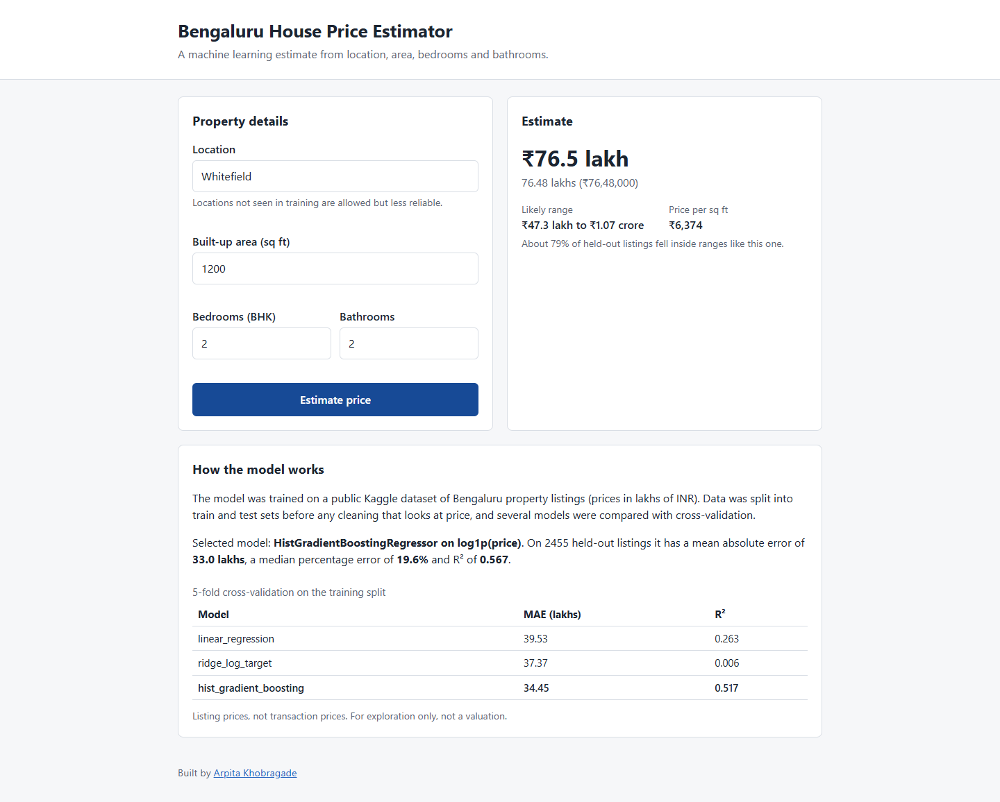
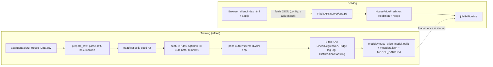
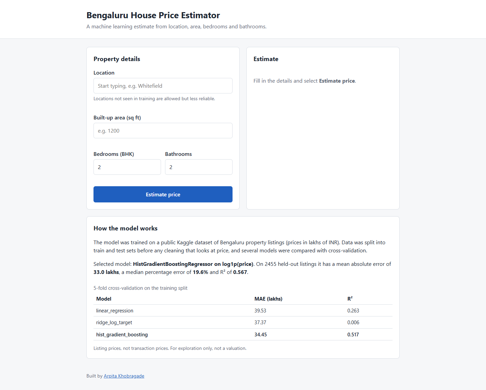
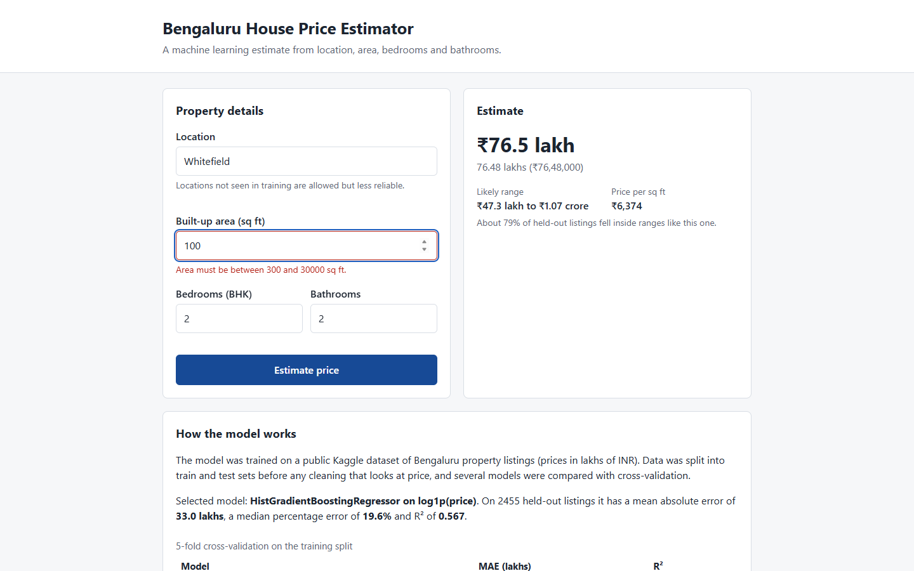

# Bengaluru House Price Prediction

Predicts Bengaluru property listing prices from location, area, bedrooms and bathrooms, served through a Flask API and a static web client.



## Overview

The model is trained on the Kaggle "Bengaluru House price data" dataset. The project consists of:

- a training CLI that splits the data before any price-based cleaning, compares three models with cross-validation, and writes a versioned model artifact, metadata and a generated model card;
- an inference layer that validates inputs with the same rules used in training and reports when a location was not seen in training;
- a Flask API with restricted CORS, structured JSON errors and a health endpoint;
- a static client that reads its API URL from a config file, so it can be deployed separately from the backend.

## Features

- Price estimate in lakhs (also shown in crores and rupees), with a 10th–90th percentile range and price per sq ft.
- Searchable list of the 144 locations the model has a dedicated category for; any other location is accepted and flagged as `location_known: false`.
- Inline field validation in the browser that mirrors the server rules; the server returns per-field `400` errors.
- "How the model works" section rendered from live `/api/model` metadata.
- `models/metadata.json` records the CV table, test metrics, data SHA-256, scikit-learn version and training timestamp; `models/MODEL_CARD.md` is generated from it.

## Architecture



## Tech Stack

| Area | Tools |
|---|---|
| ML / data | Python 3.11, pandas, NumPy, scikit-learn, joblib |
| API | Flask, flask-cors, gunicorn (production) |
| Frontend | HTML, CSS, vanilla JavaScript (fetch API), no build step |
| Quality | pytest, ruff |

## Project Structure

```
bengaluru-house-price-prediction/
├── house_price/              # Python package
│   ├── config.py             # paths, seed, validation limits
│   ├── cleaning.py           # parsing, feature rules, LocationBucketer, train-only outlier filters
│   ├── train.py              # CLI: python -m house_price.train
│   └── predictor.py          # HousePricePredictor + input validation
├── server/
│   ├── app.py                # Flask app factory create_app()
│   └── wsgi.py               # gunicorn entry point (server.wsgi:app)
├── client/
│   ├── index.html  app.js  styles.css
│   └── config.js             # window.APP_CONFIG.apiBaseUrl
├── models/                   # committed artifact so the API runs without retraining
│   ├── house_price_model.joblib
│   ├── metadata.json
│   └── MODEL_CARD.md
├── notebooks/HousePrediction.ipynb   # exploratory analysis
├── data/README.md            # how to obtain the CSV (the CSV itself is gitignored)
├── tests/                    # pytest suite (cleaning, training, predictor, API)
├── screenshots/              # images used in this README
└── requirements.txt  requirements-dev.txt  pyproject.toml  .env.example
```

## How It Works

1. The user enters a location, area, BHK and bathrooms.
2. `client/app.js` validates the form and sends a JSON `POST` to `/api/predict`.
3. The API validates the input again (same limits as training), runs the pipeline and multiplies the estimate by the stored range ratios.
4. The response contains the estimate, the range, price per sq ft and whether the location had its own category in training.

## Installation

Requires Python 3.11+.

```bash
git clone <YOUR_GITHUB_REPOSITORY_URL> bengaluru-house-price-prediction
cd bengaluru-house-price-prediction
python -m venv .venv
```

Activate the environment:

```bash
# Windows (PowerShell)
.venv\Scripts\Activate.ps1
# Windows (cmd)
.venv\Scripts\activate.bat
# macOS / Linux
source .venv/bin/activate
```

Install dependencies:

```bash
pip install -r requirements-dev.txt
```

The trained model is committed, so the dataset is only needed to retrain (see [data/README.md](data/README.md)).

## Configuration

Settings are read from the process environment. The app does not load `.env` files itself; use `.env.example` as a reference and export the values in your shell or hosting dashboard.

| Variable | Default | Purpose |
|---|---|---|
| `ALLOWED_ORIGINS` | `http://localhost:8000,http://127.0.0.1:8000` | Comma-separated origins allowed by CORS. Set to the frontend URL in production. |
| `MODEL_PATH` | `models/house_price_model.joblib` | Pipeline to load; `metadata.json` must be in the same folder. |
| `LOG_LEVEL` | `INFO` | Python logging level. |
| `PORT` | `5000` | Port for `python -m server.app`. |

## Usage

```bash
# Train (needs data/Bengaluru_House_Data.csv); overwrites models/*
python -m house_price.train

# API on http://127.0.0.1:5000 (development server)
python -m server.app

# Client on http://localhost:8000 (second terminal)
python -m http.server 8000 -d client

# Tests
python -m pytest

# Lint and format check
ruff check .
ruff format --check .
node --check client/app.js
```

## API

Base URL: `http://127.0.0.1:5000` locally. All responses are JSON.

### `GET /health`

```json
{"model_loaded": true, "model_name": "hist_gradient_boosting", "status": "ok", "version": "2.0.0"}
```

### `GET /api/locations`

```json
{"count": 144, "locations": ["1st Phase JP Nagar", "5th Phase JP Nagar", "7th Phase JP Nagar", "..."]}
```

### `GET /api/model`

Model name and description, training timestamp, data row counts, CV table, test metrics (including the methodology comparison), prediction-range parameters and validation rules, all taken from `metadata.json`.

### `POST /api/predict`

Request (`application/json`; form-encoded bodies are also accepted):

```json
{"location": "Whitefield", "total_sqft": 1200, "bath": 2, "bhk": 2}
```

Response `200`:

```json
{
  "estimate_lakhs": 76.48,
  "inputs": {"bath": 2, "bhk": 2, "location": "Whitefield", "total_sqft": 1200.0},
  "location_known": true,
  "price_per_sqft_inr": 6374,
  "range_lakhs": {"coverage": 0.787, "high": 106.82, "low": 47.26}
}
```

`coverage` is the share of held-out test listings whose actual price fell inside their predicted range.

Validation rules: `total_sqft` 300–30,000 and at least 300 sq ft per bedroom; `bhk` integer 1–10; `bath` integer, at least 1 and at most `bhk + 1`; `location` non-empty, at most 100 characters.

Response `400`:

```json
{
  "error": "validation_error",
  "message": "Invalid input.",
  "fields": {
    "bath": "Bathrooms can be at most BHK + 1 (3).",
    "total_sqft": "Area must be at least 300 sq ft per bedroom (600 sq ft for 2 BHK)."
  }
}
```

Other errors use the same shape: `404 {"error": "not_found", ...}`, `405 {"error": "method_not_allowed", ...}` (for example `GET /api/predict`), `500 {"error": "internal_error", ...}`.

## Model and Data

**Dataset.** Kaggle "Bengaluru House price data": 13,320 listings; target `price` in lakhs of INR. 13,200 rows remain after parsing. See [data/README.md](data/README.md) for download instructions.

**Cleaning (input-only, applied to every row and enforced by the API):**
- drop `area_type`, `availability`, `society`, `balcony`; drop rows with missing values;
- `total_sqft`: ranges such as `"2100 - 2850"` become their midpoint (2475); unit strings such as `"34.46Sq. Meter"` are dropped rather than guessed;
- `bhk` parsed from `size` (`"2 BHK"`, `"4 Bedroom"`);
- keep rows with at least 300 sq ft per bedroom and `bath <= bhk + 1`.

**Price-based outlier filters (training split only):** per location, keep rows whose price per sq ft is within mean ± 1 std; drop n-BHK listings priced per sq ft below the mean of (n−1)-BHK listings in the same location.

**Why split before filtering.** Both outlier filters use the price, which is the value being predicted. Applying them before the train/test split is a common pitfall: it also removes the hardest listings from the test set, so the reported score describes a cleaner population than the one the model will see. A live request has no price to filter on, so the test set keeps every row that passes the input-only rules.

**Models compared** (5-fold CV on the training split; outlier filters refit inside each training fold, validation folds untouched; selection by mean absolute error):
- `linear_regression`: baseline, one-hot location + scaled numerics;
- `ridge_log_target`: Ridge on `log1p(price)` with `log(total_sqft)` (log-log model);
- `hist_gradient_boosting`: HistGradientBoostingRegressor on `log1p(price)` with native categorical handling of location.

## Results

All numbers come from `models/metadata.json` (full dataset, seed 42, 80/20 split: 9,848 training rows, 5,686 after outlier removal; 2,455 test rows).

**Held-out test set, selected model (`hist_gradient_boosting`):**

| MAE (lakhs) | RMSE (lakhs) | R² | MAPE | Median APE | n |
|---|---|---|---|---|---|
| 32.96 | 84.07 | 0.567 | 29.2% | 19.6% | 2,455 |

**Cross-validation (training split):**

| Model | CV MAE (lakhs) | CV R² |
|---|---|---|
| linear_regression | 39.53 ± 1.79 | 0.263 ± 0.234 |
| ridge_log_target | 37.37 ± 1.69 | 0.006 ± 0.501 |
| **hist_gradient_boosting** (selected) | **34.45 ± 2.70** | **0.517 ± 0.055** |

CV R² swings a lot between folds for the linear models because a few very expensive listings dominate squared error; this is why MAE is the selection metric.

**Methodology comparison: effect of price-filtering the test set (test MAE in lakhs / R²).** The second column applies the training-only price filters to the test rows as well (1,519 of 2,455 rows remain). It is shown only to illustrate how much this inflates the scores; the first column is the project's result.

| Model | Test set, input rules only | Test rows also price-filtered |
|---|---|---|
| linear_regression | 36.85 / 0.543 | 21.30 / 0.729 |
| ridge_log_target | 33.72 / 0.573 | 18.56 / 0.730 |
| hist_gradient_boosting | 32.96 / 0.567 | 17.87 / 0.771 |

Removing 38% of test rows based on their price nearly halves the MAE, a larger effect than the choice of model.

**Prediction range.** Estimate × [0.618, 1.397] (10th and 90th percentiles of out-of-fold actual/predicted ratios). On the test set, 78.7% of actual prices fell inside the range, close to the nominal 80%.

## Screenshots

Captured from the client and API running locally with the committed model.

### Start page



### Prediction result


### Inline validation



## Deployment

Neither deployment target below has been tested with this code; the project has only been run locally.

**Backend (Render web service).** Build command `pip install -r requirements.txt`, start command `gunicorn server.wsgi:app` from the repository root. Set `ALLOWED_ORIGINS` to the frontend origin. The committed `models/` artifact is loaded at startup, so no training runs on the server. gunicorn does not run on Windows; use `python -m server.app` for local development there.

**Frontend (any static host).** Serve the `client/` directory as a static site and set `apiBaseUrl` in `client/config.js` to the backend URL.

## Design Decisions

- **Single pipeline on raw inputs.** One scikit-learn `Pipeline` (location bucketing, encoding, model) takes raw `{location, total_sqft, bath, bhk}`, so training and serving share one preprocessing path with no side files or manual one-hot vectors.
- **Train-only location vocabulary.** The `LocationBucketer` transformer learns in `fit` which locations have more than 10 training rows; everything else, including locations that appear only in the test set, maps to `other`.
- **Unknown locations flagged.** Unseen locations use the `other` category, and the API and UI report `location_known: false`.
- **CORS restricted by environment.** Only origins listed in `ALLOWED_ORIGINS` receive CORS headers; tests check that other origins get none.
- **Model loaded at startup.** The app factory `create_app()` loads the model when the app is created, so it behaves the same under `python -m server.app` and gunicorn.
- **Calibrated range.** Range multipliers are quantiles of out-of-fold actual/predicted ratios on the training split; their coverage is checked on the untouched test set.

## Limitations

- Trained on listing prices, not transaction prices.
- R² of about 0.57 and MAE of about 33 lakhs on held-out data: individual estimates can be far off, especially for expensive properties.
- Locations unseen in training (or with 10 or fewer training rows) share a city-wide `other` category.
- The dataset is a single, undated snapshot and may not reflect current prices.
- Not suitable for valuation, lending or financial decisions.

## Future Improvements

- Geocode locations to latitude/longitude so unseen locations get a neighbourhood-based estimate.
- Use `area_type` and `availability`, which are currently dropped.
- Evaluate whether the price-based outlier filters help on the held-out test set (they discard 42% of training rows), and try a quantile-loss model for the range.
- Add CI (pytest, ruff, `node --check`) on every push.

## Author

Arpita Khobragade — https://github.com/A08rpita0
